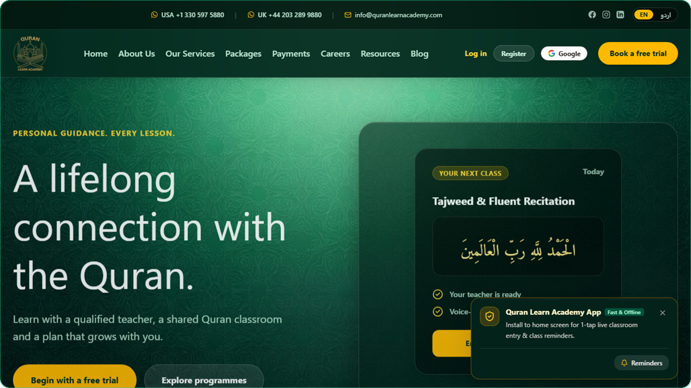

<div align="center">

# QURAN LEARN ACADEMY

**Enterprise-Grade Bilingual Islamic Pedagogy Platform**

[Explore Live Platform](https://quranacademyapp.vercel.app) · [Live Classroom Demo](https://quranacademyapp.vercel.app/classroom/demo) · [Companion Toolkit](https://quranacademyapp.vercel.app/companion)

<br />



<br />

*A production-grade, bilingual Islamic education platform engineered for 1-on-1 personalized Quran and Tajweed instruction, featuring sub-50ms synchronized WebRTC classrooms, real-time Arabic speech recognition, and institutional multi-currency direct banking rails.*

</div>

---

## Live Deployment & Links

- Production Platform: [https://quranacademyapp.vercel.app](https://quranacademyapp.vercel.app)
- Interactive Classroom Demo: [https://quranacademyapp.vercel.app/classroom/demo](https://quranacademyapp.vercel.app/classroom/demo)
- Shia Companion Toolkit: [https://quranacademyapp.vercel.app/companion](https://quranacademyapp.vercel.app/companion)
- Public Curriculum Index: [https://quranacademyapp.vercel.app/curriculum](https://quranacademyapp.vercel.app/curriculum)
- Direct Payment Portal: [https://quranacademyapp.vercel.app/payments](https://quranacademyapp.vercel.app/payments)

---

## Architectural & Technical Highlights

1. Real-Time Synchronized Classroom Engine
   - Ultra-low latency state replication operating under 50ms across WebRTC data channels and a dedicated Node.js WebSocket relay.
   - Bi-directional dual-cursor laser pointer tracking, synchronized word-by-word Mushaf highlighting, Tajweed markup pens, and isolated phoneme letter trays for Qaida instruction.
   - Integrated Google Meet-style WebRTC grid supporting adaptive bandwidth switching and OPUS 48kHz high-fidelity voice transmission.

2. Speech Recognition & Voice Follow
   - Live recitation tracking powered by Deepgram Nova-3 Multilingual Arabic streaming via WebSockets, supplemented by browser Web Speech API fallbacks.
   - Custom Arabic phonetic comparison engine with diacritic normalization and Levenshtein distance calculations.
   - Reverse-proximity search progression allowing immediate snap-back recovery when a student pauses or re-recites a prior word.

3. Pre-Flight Hardware Calibration & Diagnostics
   - Native browser device diagnostics verifying microphone, camera, and audio playback before classroom entry.
   - Live microphone decibel metering via Web Audio API AnalyserNode, synthesized dual-harmonic audio chime playback, and dynamic round-trip ping latency checks.

4. Bilingual & Directional Design System
   - Native dual-language interface supporting English and Urdu with zero layout shift between LTR and RTL orientations.
   - Typography rendered with authentic Arabic diacritics using Amiri Quran, Noto Nastaliq Urdu, and Figtree typefaces.

5. Role-Partitioned Portals & Multi-Tenancy
   - Four distinct, permission-bounded interfaces: Student, Parent, Teacher, and Administrator.
   - Strict PostgreSQL Row-Level Security (RLS) ensuring strict tenant isolation.
   - Multi-ward linkage allowing parents to manage multiple enrolled children, track lesson notes, monitor attendance, and download formal academic progress reports.

6. Institutional Multi-Currency Settlement Engine
   - Direct bank wire and local clearing integration bypassing third-party card processors.
   - Supports verified domestic rails across the United Kingdom (Barclays FPS), United States (Chase ACH/Wire/Zelle), Eurozone (Wise SEPA Instant), and Pakistan (Meezan Bank, Raast Instant ID, JazzCash, EasyPaisa).
   - Automated dynamic vector PDF invoice and tax receipt generation via React-PDF, compliant with educational tax exemption standards.

7. Child Safety & Safeguarding Controls
   - Parental consent verification enforced prior to enabling session recording features.
   - Strict Personally Identifiable Information (PII) partitioning preventing tutors from accessing student phone numbers or personal email addresses.
   - Anonymous parental observer mode enabling silent classroom monitoring with disabled camera and microphone feeds.
   - Immutable append-only audit logs recording administrative approvals, user verification, and financial status transitions.

---

## Technology Stack

### Core
- Next.js 16 (App Router with Turbopack)
- React 19
- TypeScript (Strict Mode)
- Node.js Runtime

### Styling & Design System
- Tailwind CSS v4
- Framer Motion
- Lucide React
- Amiri Quran, Noto Nastaliq Urdu, and Figtree Typography

### Architecture & Real-Time Services
- LiveKit Cloud WebRTC (Audio/Video Data Channels)
- Node.js WebSocket State Server (Classroom Synchronization)
- Supabase (PostgreSQL Database, Auth SSR, Row-Level Security)
- Deepgram Nova-3 (Arabic Speech-to-Text Streaming)
- React-PDF (Dynamic Vector Tax Invoicing)
- Resend API (Transactional Email Messaging)

### Deployment & Quality Assurance
- Vercel Edge Platform
- Vitest Suite (Unit, Integration, and Lifecycle Testing)
- Strict ESLint and TypeScript Compiler Verification
- GitHub Actions CI/CD Pipeline

---

## Local Development

### Prerequisites
- Node.js 20 or higher
- pnpm package manager (v9+)
- Git

### Installation & Execution
1. Clone the repository:
   ```bash
   git clone https://github.com/mdawoodali/QURAN-ACADEMY-APP.git
   cd QURAN-ACADEMY-APP
   ```

2. Install dependencies:
   ```bash
   pnpm install
   ```

3. Configure environment variables:
   ```bash
   cp .env.example apps/web/.env.local
   ```

4. Launch the application:
   ```bash
   # Terminal 1: Real-time WebSocket relay
   cd apps/ws
   npm run dev

   # Terminal 2: Next.js frontend (from repository root)
   pnpm dev
   ```

---

## License
Commercial and proprietary. All rights reserved by Quran Learn Academy Global.
